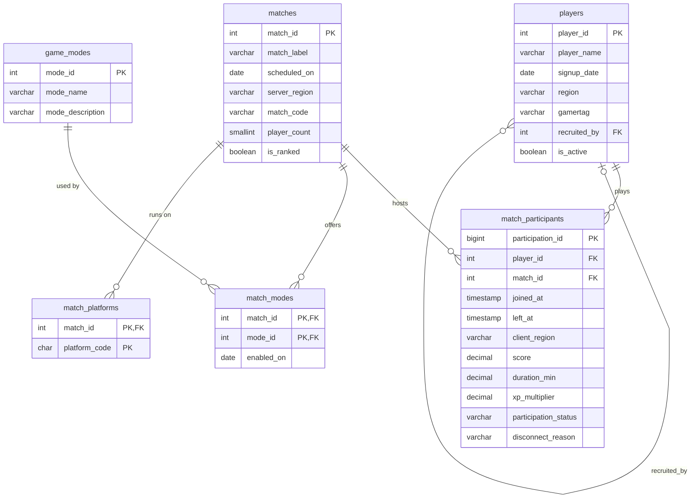

# Game Telemetry Failure Analysis

A SQL analysis of a multiplayer game telemetry database, checking a misleading failure-rate dashboard and working out whether the platform is getting better or worse.

## The Domain

**Theme:** Game Telemetry

The platform records game matches, the players that participate, when they joined and left, where they connected from, what they scored and how the session ended.

This analysis was the result of a dashboard claiming half of all matches were failing. 
The questions the platform had to answer were:

- What is the real failure rate?
- Which matches are failing and what do they have in common?
- Is the failure problem getting better or worse over time, and what should the team do next quarter?

A failure throughout this analysis means a session dropped by a **network timeout, server restart or client crash**. A player choosing to quit is not a platform failure.

## Database Overview

The database is the reference dataset provided in Unit 3, defined and loaded by [gaming.sql](gaming.sql) (PostgreSQL 14 or later). It holds 30 players, 15 matches and 200 sessions covering 2023.



| Table | Used for |
|---|---|
| `match_participants` | The high volume fact table, one row per session. `score`, `participation_status` and `disconnect_reason` are used in most queries. `disconnect_reason` is nullable, which may have caused the Unit 3 dashboard bug. |
| `matches` | One row per match. Grouped by `server_region` for the regional breakdowns. `player_count` turned out not to agree with `match_participants` aggregated player counts. |
| `players` | Player names and home `region`, compared with `client_region` to spot cross-region sessions. |
| `game_modes` / `match_modes` | Which modes each match offers. |
| `match_platforms` | Platforms each match runs on. |

**A note on what a "match" is:** every session on a match is spread across the whole of 2023 (match 2 runs from January to December), so I treat a match as a long-running game server and each participation as one session on it.

> The [schema/](schema/) folder and the Unit 1 and 2 write-ups are from an earlier design exercise and don't reflect the dataset analysed here. Use [gaming.sql](gaming.sql) to set up the database.

## Query Catalogue

### Unit 3

| File | Query | Business question |
|---|---|---|
| [q3_1.sql](queries/unit3/q3_1.sql) | 3.1a–e | What does the match data actually contain: which participation statuses and disconnect reasons appear, and is anything unexpected? |
| [q3_2.sql](queries/unit3/q3_2.sql) | Part A | Which sessions did the dashboard's failure query silently drop because `disconnect_reason` is NULL, and how is it fixed? |
| [q3_2.sql](queries/unit3/q3_2.sql) | Part B | Why does the dashboard query error when it filters on a column alias, and how is it fixed? |
| [q3_3.sql](queries/unit3/q3_3.sql) | 3.3 | How many sessions ended in a network timeout, and which matches and players were involved? Written three ways (subquery, CTE, set difference) and checked to return the same rows. |

### Unit 4

| File | Query | Business question |
|---|---|---|
| [q4_1.sql](queries/unit4/q4_1.sql) | 4.1.1 | What are the count, total, average, minimum and maximum score across all sessions, and how many distinct players appear? |
| [q4_1.sql](queries/unit4/q4_1.sql) | 4.1.2 | How many sessions and what average score does each match have, from busiest to quietest? |
| [q4_1.sql](queries/unit4/q4_1.sql) | 4.1.3 | Which matches have enough sessions (15 or more) for their failure rate to mean anything? |
| [q4_1.sql](queries/unit4/q4_1.sql) | 4.1.4 | How do sessions, score and abandonment vary across each combination of server region and the player's connecting region? |
| [q4_2.sql](queries/unit4/q4_2.sql) | Part A | For each match, how many sessions were there and how many ended in a failure (in total and by type), in one pass? |
| [q4_2.sql](queries/unit4/q4_2.sql) | Part B | What are the failure subtotals for each server region and the platform grand total, without the detail rows? |
| [q4_2.sql](queries/unit4/q4_2.sql) | Part C | What is the baseline failure rate for high-volume matches (15 or more sessions)? |

### Unit 5

| File | Query | Business question |
|---|---|---|
| [q5_1.sql](queries/unit5/q5_1.sql) | Q1 | Who played on the matches flagged in Unit 4, when did they join and leave, how did each session end, and were they connecting from another region? |
| [q5_1.sql](queries/unit5/q5_1.sql) | Q2 | Which game modes does each match offer, and do the flagged matches share any? |
| [q5_1.sql](queries/unit5/q5_1.sql) | Q3 | How do the flagged matches compare with other matches in the same server region? |
| [q5_2.sql](queries/unit5/q5_2.sql) | Part A | Which matches does an INNER JOIN leave out that a LEFT JOIN keeps, and does each match's recorded player count agree with its sessions? |
| [q5_2.sql](queries/unit5/q5_2.sql) | Part B | Does a RIGHT JOIN return the same records as the LEFT JOIN, and does a FULL OUTER JOIN find any sessions with no match? |
| [q5_2.sql](queries/unit5/q5_2.sql) | Part C | Are there matches that have never had a session (NOT EXISTS vs EXCEPT)? |
| [q5_3.sql](queries/unit5/q5_3.sql) | Part A | Does pairing every match platform with every game mode (CROSS JOIN) return the product of the two tables' row counts? |
| [q5_3.sql](queries/unit5/q5_3.sql) | Part B | How does PostgreSQL plan to execute the three-table incident join from Task 5.1, and what might change as the platform grows? |

### Unit 6

| File | Query | Business question |
|---|---|---|
| [q6_1.sql](queries/unit6/q6_1.sql) | Q1a / Q1b | Is a session's score unusual for its own match? Compared with the GROUP BY version: how many rows does each return, and what is lost? |
| [q6_1.sql](queries/unit6/q6_1.sql) | Q2 | How do matches rank by number of sessions on a leaderboard, and how do ROW_NUMBER, RANK and DENSE_RANK handle a tie? |
| [q6_1.sql](queries/unit6/q6_1.sql) | Q3 | How do matches split into four bands by number of sessions, and what happens to tied matches at a band boundary? |
| [q6_2.sql](queries/unit6/q6_2.sql) | Part A | Is a match's session score going up or down over time, compared with the previous and next session? |
| [q6_2.sql](queries/unit6/q6_2.sql) | Part B | How is the platform doing over time, in total and on a recent average, and how close does each quarter get to its 50-session target? |
| [q6_2.sql](queries/unit6/q6_2.sql) | Part C | Which matches stop having sessions for a while and then start again, and how long is the gap? |
| [q6_3.sql](queries/unit6/q6_3.sql) | Part A | What are the top three sessions by score on each match? |
| [q6_3.sql](queries/unit6/q6_3.sql) | Part B | Is the platform getting better or worse each month? |

### Analysis and findings

| Unit | Write-up | Findings memo |
|---|---|---|
| 3 | | [unit3-finding.md](analysis/unit3-finding.md) |
| 4 | [unit4.md](analysis/unit4.md) | [unit4-finding.md](analysis/unit4-finding.md) |
| 5 | [unit5.md](analysis/unit5.md) | [unit5-finding.md](analysis/unit5-finding.md) |
| 6 | [unit6.md](analysis/unit6.md) | [unit6-finding.md](analysis/unit6-finding.md) |

Query and result screenshots for each unit are in [screenshots/](screenshots/).

## Technical Highlights

- **Handling NULLs with COALESCE** ([q3_2.sql](queries/unit3/q3_2.sql)). `disconnect_reason <> 'Network timeout'` drops every row where the reason is NULL, because of SQL's three-valued logic. That was 166 of 200 rows. Wrapping it in `COALESCE` kept them in the count and explained how the dashboard could be so far off.
- **Conditional aggregation with ROLLUP** ([q4_2.sql](queries/unit4/q4_2.sql)). `COUNT(CASE WHEN ...)` breaks failures down by match and by cause in one pass. `ROLLUP` adds a grand total in addition to the regional groupings. This is what got the real failure rate (13.5%) and pointed at the APAC servers.
- **LAG in a CTE for gap detection** ([q6_2.sql](queries/unit6/q6_2.sql), Part C). `LAG(joined_at)` compares each session with the one before it on the same server. The window function is in a CTE so the outer query can filter to the long gaps.

## Findings and Recommendations

1. **The dashboard was wrong.** The real failure rate is 27 of 200 sessions (13.5%), not half. Failures are concentrated on a few servers: APAC matches 2 and 11 each fail 25% of sessions, about double the 12% baseline. In Unit 6, match 11 went 89 days with no sessions, and the sessions on both sides of the gap failed, which suggests the server was taken offline and brought back before the problem was fixed. **Recommendation:** the APAC server team should fix matches 11 and 2 first, and use the same LAG comparison to flag any server that fails two sessions in a row.
2. **The failure problem is getting better, but the platform isn't growing.** The failure rate fell every quarter, from 18.9% in Q1 to 10.4% in Q4. Sessions stayed flat at 48 to 53 a quarter and never got back to January and February's 21 a month. **Recommendation:** hold off on growth campaigns until APAC is fixed. Bringing new players onto servers that still drop 1 in 10 sessions isn't a good first experience.
3. **The match records can't be trusted.** Only one match's `player_count` agrees with its recorded sessions, and matches 14 and 15 have no sessions or game modes at all. **Recommendation:** engineering should find out why `player_count` doesn't add up and decide whether matches 14 and 15 need fixing or removing.

The full closing memo is in [unit6-finding.md](analysis/unit6-finding.md).

## Limitations and Future Improvements

The data records whether a *player's session* failed, not whether a *match* failed, so everything here is a session failure rate. The `matches` table would need additional status fields and a timestamp for match end to report on that separately. 

Additionally there are only 200 sessions, a relatively small data set. A single extra failure a quarter could sway the rate significantly. If the issues are resolved, game growth will happen naturally and with more volume comes more reliable metrics.

## Video Presentation
[https://github.com/user-attachments/assets/1f747046-ca7c-44f4-bfe7-e22cb49ee357]

## How to Run It

**Load Script:** [gaming.sql](/gaming.sql)
   ```bash
   createdb game_telemetry
   psql -d game_telemetry -f gaming.sql
   ```
